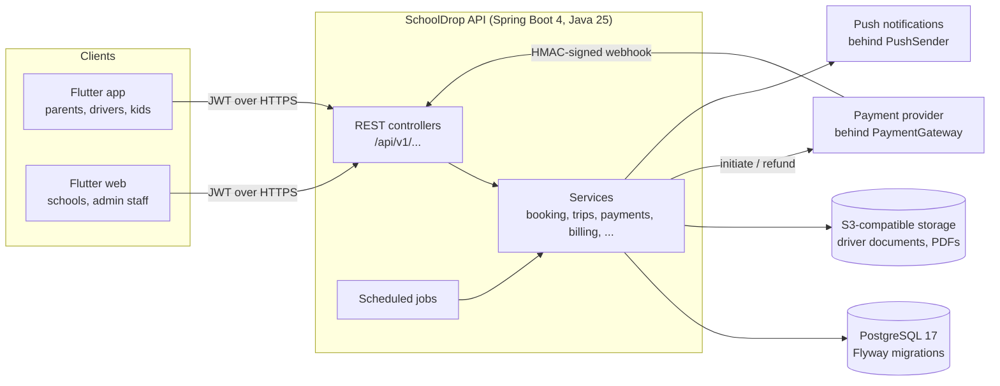

# SchoolDrop — Architecture

SchoolDrop connects Botswana families with vetted school-transport drivers. This page covers how the backend is built and why. The README covers running it and the main user flows.

## Context

One deployable: a Spring Boot application with PostgreSQL and object storage. The Flutter app (mobile and web, one codebase) is in a separate repository.

## Code layout

| Package | Responsibility |
|---|---|
| `controllers` | One controller per area (`/v1/parent`, `/v1/driver`, `/v1/school`, `/v1/kid`, `/v1/admin`, account, billing, payments). Thin: validate, call a service, map to a DTO |
| `services` | Business rules and transactions: bookings, trips, payments, payouts, invoices, onboarding, teams, adverts, audit |
| `entities` / `repositories` | JPA entities and Spring Data repositories; schema owned by Flyway (`db/migration`), Hibernate only validates |
| `payments` | `PaymentGateway` interface, sandbox implementation, webhook signature |
| `security` | Spring Security config, JWT, refresh tokens, field encryption, rate limiting, onboarding and password-change guards |
| `storage` | S3-compatible file storage and upload validation |
| `billing` | Invoice PDFs and signed download links |
| `notifications` | `PushSender` interface (logs for now) and in-app inbox |

## Key flows

**Booking the last seat.** The parent picks an offer; the service takes a pessimistic write lock on the offer row (`SELECT … FOR UPDATE`), counts the seats already held or sold, and creates the booking in `PENDING_PAYMENT` for 30 minutes. Two parents racing for the last seat are serialised by the database; the end-to-end script tests exactly that race. A scheduled job releases unpaid holds every minute.

**Payment.** `PaymentService` asks the gateway to start collection and stores the provider reference. The result arrives later by webhook, signed with HMAC-SHA256 over the raw body and compared in constant time. `handleResult` is idempotent: repeats are ignored, and a success arriving after the attempt was cancelled is refunded automatically. The platform fee is split at payment time and the payee is fixed then, so a driver leaving a team later doesn't move money already earned.

**Money out.** Earnings become payable when the service starts. A weekly job batches them into payouts; finance sends the money and marks each payout paid, which issues a payout statement.

**Documents.** Every movement of money issues a numbered receipt, invoice, credit note or statement from a gap-free series per type, with names and amounts snapshotted so later profile edits can't rewrite history. A startup backfill gives a document to any payment that lacks one.

## Security and privacy

- **Identity documents and payout accounts are encrypted in the application** with AES-256-GCM before they reach the database (`EncryptedStringConverter`), so database dumps and backups don't expose them. The key must be exactly 32 bytes or the app refuses to start.
- **Authentication:** short-lived JWT access tokens and per-device refresh tokens. Only a SHA-256 hash of each refresh token is stored, and tokens rotate on use. Presenting an already-used or revoked refresh token is treated as theft and revokes every session for that user. Changing email or password moves a per-user `sessionsValidFrom` timestamp, so every access token issued earlier is rejected immediately, not just refresh tokens.
- **Passwords:** BCrypt (cost 12) with a strength policy shared by the API and the app.
- **Authorisation:** one URL area per role, plus fine-grained staff permissions (`SUPER_ADMIN`, `VERIFIER`, `SUPPORT`, `FINANCE`, `MARKETING`, `VIEWER`) checked with `@PreAuthorize`. The last super admin can't be disabled or demoted.
- **Audit log:** written in the same transaction as the change it records, so it can't say something happened that was rolled back.
- **Rate limiting** on every credential endpoint (login, register, refresh, kid pairing, password-checked account changes).
- **Uploads** accepted only as PDF, JPEG or PNG, judged by magic bytes rather than the client's content type.
- **PDF links** are signed per document with a derived key and expire after 10 minutes, so share sheets work without exposing the bearer token.
- **Production profile has no secret defaults:** a missing secret stops startup. Stack traces and error messages are never returned to clients; API docs are off unless enabled.
- **Child safety:** everyone who can see children's details is vetted individually, documents expire and lapse automatically, and every handover is confirmed by both sides with who and when.

## Trade-offs

| Decision | Chosen | Alternative | Why |
|---|---|---|---|
| Service shape | Modular monolith, one deployable | Microservices | One developer, one database, strong transactional consistency between bookings, payments and invoices. Package boundaries keep a later split possible |
| Seat contention | Pessimistic row lock while counting seats | Optimistic locking with retries | Contention is rare but the cost of overselling a child's seat is high; a short lock is simpler to reason about than retry loops. `@Version` still guards ordinary edits |
| Payment provider | Interface + sandbox, async signed webhook | Integrate one provider directly | No merchant accounts yet; the whole product can be built and tested end to end, and Orange Money, MyZaka, Smega or an aggregator plug in later |
| Sensitive fields | Application-level AES-GCM | Database or disk encryption only | Protects data in dumps and backups and from anyone with SQL access. Cost: those columns can't be searched, and losing the key loses the data, so key backup is a deployment requirement |
| Sessions | Stateless JWT plus a per-user revocation timestamp | Server-side sessions | Works for mobile and web alike; the timestamp check gives instant sign-out-everywhere at the cost of reading the user on each request, which the filter does anyway |
| Background work and rate limits | In-process `@Scheduled` jobs and in-memory counters | ShedLock, Redis or a job queue | Correct and simple for a single instance. Scaling out needs a distributed lock and shared counters (tracked as an issue) |
| Driver verification | Manual document review by staff | Automated checks | Botswana has no public API for police clearance, Omang or licence checks. Numbers are stored so automation can be added if an agreement is reached |
| Paying drivers directly | Supported, outside the platform's books | In-app payment only | Many families pay cash or EFT; recording it keeps trips and receipts accurate without SchoolDrop touching that money |

## Testing

- Unit tests for pricing, encryption, webhook signatures, upload validation, signed links and phone normalisation.
- Integration tests (`*IT`) on Testcontainers PostgreSQL 17 with the real Flyway migrations.
- `scripts/e2e.py`: 150 checks across every flow against a running server, including the last-seat race, RBAC and the audit log.
- CI runs the tests and builds the container image on every push.

## Open work

Tracked as [GitHub issues](https://github.com/GimbleBDub/schooldrop-be/issues): real payment providers, push notifications, production storage, verification agreements, PSV permit rules, public holidays, email flows, profile photos and running more than one instance.
